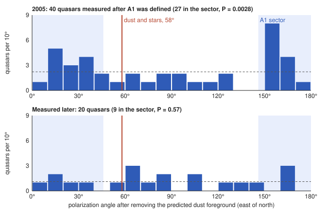

# Entry 182: region A1 on quasars measured after 2005

**Bottom line: not repeated.** Entry 175 found that the alignment Hutsemékers et al. reported in region A1 is not made by Galactic dust. This entry tests it on 20 quasars in A1 that were measured later and never used in any alignment study. After the dust correction, 9 of the 20 fall in the predicted sector, where uniform angles give 8.9: P = 0.57. The frozen rule's verdict is *not repeated*: the 95% upper bound on the share is 0.653, below the 2005 rate of 0.675. At that rate, 9 or fewer would happen 3.1% of the time. The corrected angles have no preferred direction (Rayleigh R = 0.13, P = 0.73). Their mean, 58°, is the Galactic direction in this patch. Combined with the 40 quasars of 2005 the count is 36 of 60, P = 0.011.

## Rule

Workbench section 182, "Region A1 on quasars measured after 2005: the rule, frozen first". It was fixed at 18:08 UTC on 21 November 2026 (commit `ff019f0`) and published as Workbench version 195, before any row of either table was read.

## Data

Read in browser memory from VizieR (vizier.cfa.harvard.edu). No file was downloaded.
- `J/A+A/606/A101/table4`: Hutsemékers, Hall & Sluse 2017, A&A 606, A101. EFOSC2 at La Silla, 2003 and 2007; 192 rows.
- `J/A+A/620/A68/table3`: Hutsemékers, Borguet, Sluse & Pelgrims 2018, A&A 620, A68. FORS at the VLT, 2008 and 2015; 87 rows.

Local data, as in Entry 175:
- Planck GNILC dust map, `data/planck-pr3-gnilc-dust/COM_CompMap_IQU-thermaldust-gnilc-unires_2048_R3.00.fits` (IRSA, 1,811,949,120 bytes);
- the 355 quasars, `data/hutsemekers-2005/qsos.tsv` (VizieR J/A+A/441/915/qsos).

## Steps

1. `a1_new.js` part 1 loads both tables in the browser and passes on only index, position and redshift. A generous cut keeps 109 rows near A1 or A3, saved in `positions.txt`.
2. `foreground.py` computes, for each of those rows:
   - B1950 right ascension and Galactic latitude;
   - the region flags;
   - the 10″ match to the 355 (5 rows matched and were left out);
   - groups of duplicate rows;
   - Planck's predicted foreground, with Entry 175's code (`qso_dust.py`, copied unchanged).

   It writes `foreground.json`.
3. `a1_new.js` part 2 applies the frozen cuts in the browser (p ≥ 0.6%, angle error ≤ 14°, |b| ≥ 30°) and the correction, and makes the count. The per-quasar values are in `results.json`.

Deviation: before the run, part 2 was found to let a blank angle-error field read as 0. It was changed to reject rows with blank polarization fields. This is a code fix made before any count was seen; the rule is unchanged.

## Result

| | n | in sector | P (binomial, 80/180) | V toward 6° |
|---|---|---|---|---|
| measured | 20 | 9 | 0.57 | −0.32 |
| **Planck's foreground removed (f = 1)** | 20 | **9** | **0.57** | −0.20 |
| twice the foreground removed | 20 | 9 | 0.57 | −0.16 |

- **Frozen decision: not repeated.** n ≥ 10 and P > 0.00135. The one-sided 95% upper bound on k/n (Clopper–Pearson) is 0.653, below the 2005 new-sample rate of 0.675.
- **Reported only:**
  - combined with the 2005 new sample: 36 of 60, P = 0.011;
  - A3 (the Galactic control): only 3 new quasars, 2 in the sector; too few to read.
- **Post hoc:**
  - After the correction the mean angle is 58° (Rayleigh R = 0.13, P = 0.73), the direction of the dust and the stars in this patch (Entry 175).
  - The link to the foreground direction is +0.14 before and +0.07 after the correction, as Entry 175's selection effect gives.
  - The three members of the large quasar group at Dec +24° to +28° make little difference: without them, 8 of 17.
  - By catalogue: La Silla 3 of 5, VLT 6 of 15.

*Figure 1 (`figure.py`). Corrected angles in A1. Top: the 40 quasars of 2005 measured after A1 was defined. Bottom: the 20 measured later. Shaded: the sector set in 1998. Dashed: uniform angles. Red: the direction of dust and stars in the patch.*

## Reading

- Entry 175 split the 2005 alignment into a part that dust explains (the full-sample statistic and region A3) and a part it does not (region A1, P = 0.0028 on the 40 quasars measured after A1 was defined).
- Twenty quasars measured later in A1 do not show the A1 alignment at all.
- What remains of A1 is the 2005 sample: a region and sector chosen by eye from earlier data, then confirmed once at P = 0.003. A second independent sample does not confirm it.
- Together, the quasar optical polarization alignment has no part that both survives the dust correction and repeats on new quasars.
- The count is small. Twenty quasars exclude the 2005 rate at about 97% confidence, not more.

## Files

`a1_new.js`, `positions.txt`, `foreground.py`, `foreground.json`, `qso_dust.py` (Entry 175, unchanged), `results.json`, `figure.py`, `figure1.svg`.
